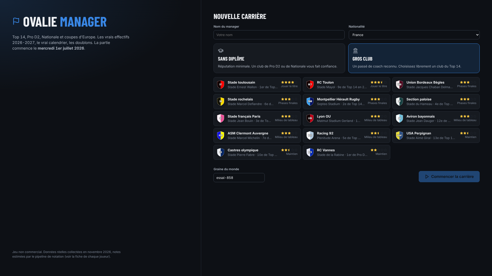
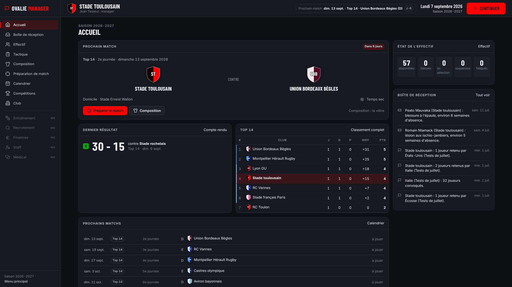
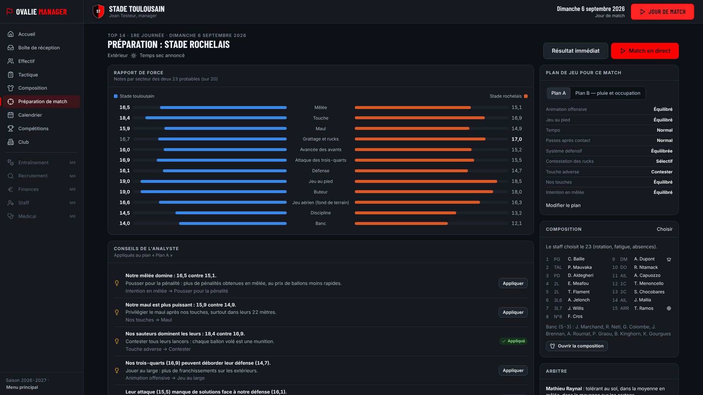
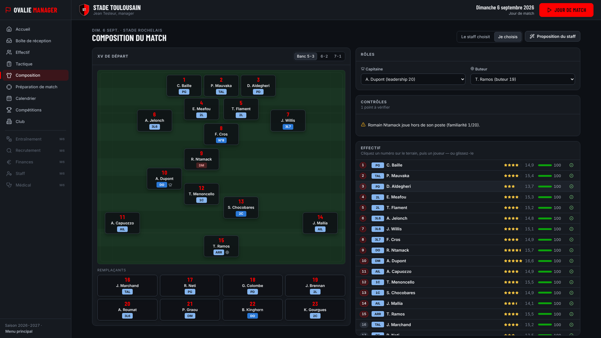
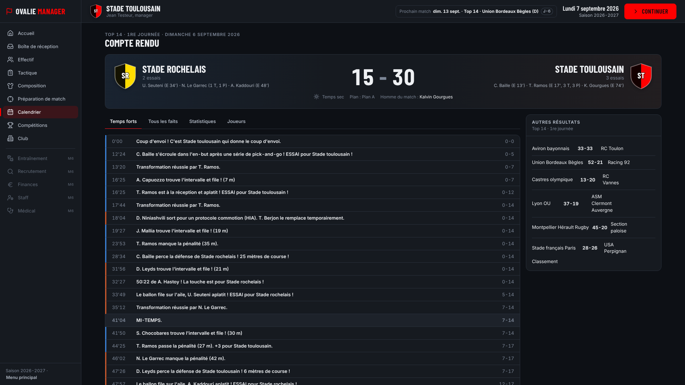
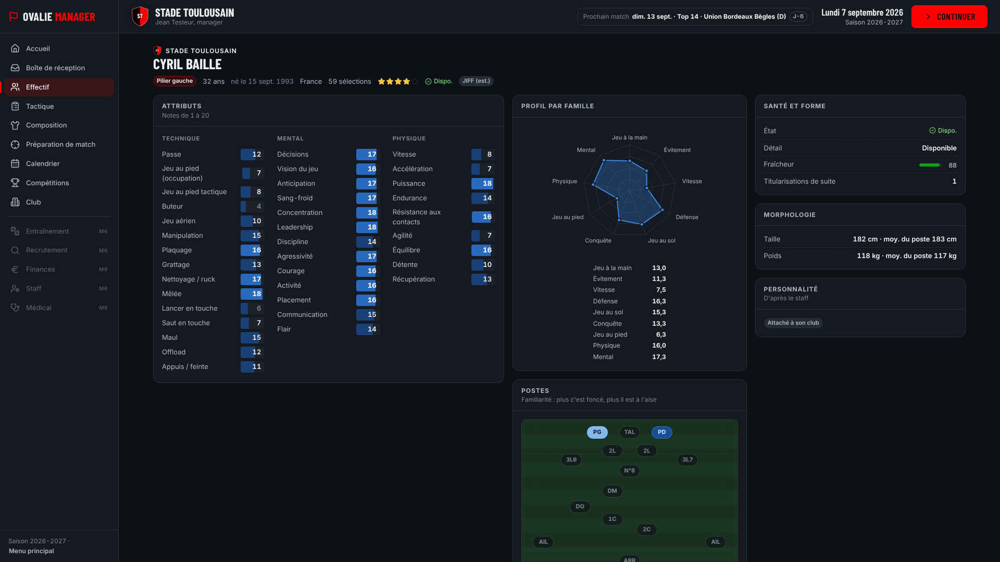

# Interface manager (M4)

Code : `apps/game` (React 18 + Vite 5, TypeScript) et, côté moteur, `packages/engine/src/world/manager.ts`, `world/scouting.ts` et `squad/analysis.ts`.

```bash
pnpm install
pnpm jeu                              # http://localhost:5173
pnpm build                            # version de production dans apps/game/dist
pnpm --filter @ovalie/game smoke      # parcours complet dans Chromium + captures (après pnpm build)
```

| | |
|---|---|
|  |  |
|  |  |
|  |  |

## Architecture

```
 interface (React, fil principal)                  worker (Web Worker)
 ─────────────────────────────────                 ───────────────────────────────
 écrans ── lectures pures sur l'instantané ──┐     possède le monde (World)
   (classements, rapport de l'analyste,      │     base réelle + calendrier embarqués
    contrôles de composition…)               │     continueCareer / playMatchDay
 game/client.ts ── commandes ─────────────────┼──▶ game/session.ts
               ◀── instantané du monde ───────┘     sauvegarde automatique (IndexedDB)
```

- Le **worker possède le monde** : toute modification passe par une commande (`newGame`, `continue`, `playMatch`, `updateManager`…, voir `game/protocol.ts`). Il renvoie un instantané (clone structuré, ~25 ms pour 4 à 7 Mo), que l'interface traite comme immuable.
- Les **lectures** (classements, rapport de l'analyste, contrôles de la feuille de match) sont des fonctions pures du moteur appelées sur l'instantané : rien de la logique de jeu n'est dupliqué dans l'interface.
- La base (4,4 Mo de JSON) n'est chargée que dans le worker ; l'interface pèse ~280 Ko (90 Ko compressés).
- **Sauvegarde automatique** après chaque commande, dans un emplacement unique IndexedDB : « Reprendre » sur l'écran titre. Les vraies sauvegardes multiples restent pour M8.
- Routage par ancre (`#/effectif`, `#/joueur/antoine-dupont`…) : précédent et suivant du navigateur fonctionnent.
- Polices embarquées (`@fontsource`), aucune ressource réseau : prêt pour l'application de bureau (Tauri, M8).

## La carrière dans le moteur

`World.manager` (`ManagerState`) décrit la carrière : profil (nom, nationalité, départ « Sans diplôme » ou « Gros club »), club, **plans tactiques** (plan A et plan B), plan choisi pour un match précis, **composition** et messages lus.

| Fonction | Rôle |
|---|---|
| `startCareer(monde, profil, club)` | Démarre la carrière dans un club de Top 14, Pro D2 ou Nationale (GDD §2.2). |
| `continueCareer(monde)` | « Continuer » : avance jour par jour et s'arrête **le matin d'un match du club** (sans le jouer), après une **actualité importante** pour le club (blessure longue, convocations, suspension…) ou à la **fin de la saison**. |
| `playMatchDay(monde)` | Joue la journée, match du manager compris. |
| `managedTeam` | Le 23 du manager : celui du staff (mêmes règles que les clubs IA : disponibilités, rotation, fraîcheur) ou le sien. Un joueur devenu indisponible est remplacé par le meilleur joueur disponible au poste, et **le staff le signale** (actualité et compte rendu). |
| `lineupIssues` | Contrôles de la feuille : joueur absent ou en double, pilier ou talonneur non spécialiste (mêlées simulées), joueur hors de son poste, fatigue, pas de 1re ligne spécialiste sur le banc, capitaine ou buteur non titulaire. |
| `recordReport` | Compte rendu complet des matchs du manager (`World.reports`) : 23 et tactiques des deux équipes, événements, statistiques, notes, blessures, changements du staff. |
| `sectorRatings` | Notes par secteur d'un 23 (mêlée, touche, maul, rucks, avancée des avants, attaque des trois-quarts, défense, jeu au pied, buteur, jeu aérien, discipline, banc), calculées à partir des **mêmes attributs** que ceux qu'utilise le moteur dans chaque phase. |
| `scoutReport` | Rapport de l'analyste sur un adversaire : 23 probable à la date du match, points forts et faibles par rapport à la moyenne de son championnat, joueurs clés, forme, bilan, absents, cartons. |
| `analystAdvice` | Conseils tactiques applicables en un clic, chacun relié à un mécanisme réel du moteur (par exemple « Notre mêlée domine : pousser pour la pénalité »). Les duels entre secteurs différents (notre attaque contre leur défense) comparent des écarts à la moyenne du championnat. |
| `fixtureWeather` | La météo d'un match est tirée de sa graine : l'analyste l'annonce à l'avance, et c'est bien celle du match. |

**Neutralité** : une carrière où le staff compose l'équipe produit exactement les mêmes résultats qu'une simulation sans manager (test `manager.test.ts`). Le calibrage reste donc valable (29/29).

Avec « Résultat immédiat », les décisions sur pénalité suivent la recommandation du staff (`controller: "ai"`). En direct (M5), le manager les prend lui-même : voir `docs/08-match-en-direct.md`.

## Le système de design

Thème sombre unique (GDD §8), tokens dans `src/styles/tokens.css`, composants dans `src/ui/`.

| Élément | Choix |
|---|---|
| Surfaces | `--bg` #0d1015 → `--surface-1/2/3` ; bordures discrètes |
| Typographie | **Barlow Condensed** (titres, scores, en capitales) et **Inter** (texte, chiffres tabulaires) |
| Accent | Couleur du club du manager, calculée par `clubAccent` : la plus colorée des deux couleurs du club, éclaircie jusqu'à **3:1** sur la surface et **4,5:1** pour le texte des boutons (vérifié par un test pour les 44 clubs jouables) |
| Données « nous / eux » | Bleu `#3987e5` / orange `#d95926`, paire validée (daltonisme, contraste) sur la surface sombre ; les valeurs sont toujours écrites à côté des barres |
| Statuts | Vert, jaune, orange, rouge réservés aux états (disponible, sélection, fatigue, blessure…), **toujours avec une icône et un libellé** |
| Attributs 1-20 | Le chiffre en clair sur une barre de magnitude (une seule teinte), en gras à partir de 16 |
| Familiarité au poste | Rampe bleue en 5 paliers ; rouge et orange signalent un joueur hors de son poste |

Composants : `Panel`, `PageHeader`, `Button`, `Segmented`, `Tabs`, `Badge`, `StatusPill`, `Stars` (niveau et potentiel, de 0,5 à 5 étoiles), `AttrValue`, `Freshness`, `ClubCrest` (écusson aux couleurs du club), `ResultChip`, `CompareRow`, `Radar`, `DataTable` (triable), `Pitch` / `PitchSlot` ; widgets de jeu dans `ui/widgets.tsx` (ligne de match, classement, actualités, liens joueur et club).

## Les écrans

Barre latérale fixe (GDD §8) et bouton **Continuer** toujours visible ; il devient « Jour de match » puis « Bilan de saison ». Les rubriques de M6 (entraînement, recrutement, finances, staff, médical) sont affichées mais grisées.

| Écran | Contenu |
|---|---|
| **Nouvelle carrière** | Nom, nationalité, départ « Sans diplôme » (Pro D2 ou Nationale) ou « Gros club » (Top 14), choix du club avec stade, classement 2025-26, niveau en étoiles et objectif indicatif ; graine du monde ; reprise de la partie sauvegardée. |
| **Accueil** | Prochain match (adversaire, lieu, météo annoncée, compte à rebours), dernier résultat, classement autour du club, état de l'effectif (disponibles, blessés, en sélection, suspendus, fatigués), boîte de réception, prochains matchs. |
| **Boîte de réception** | Actualités du club et grands titres, filtres (club, médical, sélections, compétitions), non lus mis en évidence. |
| **Effectif** | Tableau dense et triable : poste et postes secondaires, âge, nationalité, taille et poids, niveau et potentiel, fraîcheur, état, sélections, statistiques de la saison ; filtres avants, arrières, disponibles. Aussi pour les autres clubs. |
| **Fiche joueur** | 37 attributs par famille, radar par famille (valeurs listées à côté), familiarité sur un terrain, santé et forme, morphologie comparée à la moyenne du poste (valeurs estimées signalées), personnalité décrite par le staff (attributs cachés jamais chiffrés), statistiques par compétition, parcours et statut JIFF, et **« D'où vient sa note ? »** : la note décomposée (temps de jeu, sélections, âge, force du club, ajustement manuel) avec sa fiabilité. |
| **Tactique** | Plans A et B renommables, plan par défaut, les 9 consignes du moteur avec, pour chaque choix, **son effet réel** dans la simulation (chiffres tirés du code du moteur). |
| **Composition** | XV sur un terrain et banc de 8 (5-3, 6-2 ou 7-1) ; clic sur un numéro puis sur un joueur (liste triée par adéquation au poste), ou glisser-déposer, avec échange automatique ; capitaine et buteur ; contrôles en direct ; « Le staff choisit » ou « Je choisis » ; proposition du staff. |
| **Préparation de match** | Rapport de force par secteur (nous contre eux), conseils de l'analyste à appliquer au plan du match, rapport sur l'adversaire, choix du plan A ou B pour ce match, résumé de la composition, arbitre désigné (M5), consignes ciblées et règles de pénalité (M5), boutons « Résultat immédiat » et « Match en direct » (M5). |
| **Compte rendu** | Tableau d'affichage (marqueurs, bonus, météo, plan, homme du match), temps forts ou tous les faits commentés en français, statistiques comparées, notes des joueurs, blessures, changements du staff, autres résultats de la journée. |
| **Calendrier** | Matchs du club mois par mois, filtre par compétition, fenêtres internationales (doublons) signalées. |
| **Compétitions** | Top 14, Pro D2, Nationale, Champions Cup, Challenge Cup, PREM, URC, Nations Championship, Six Nations : classement (zones de qualification, access match, relégation), poules, résultats par journée, phases finales, meilleurs marqueurs. |
| **Club** | Stade, capacité, président, manager, budget, saison passée, profil de l'effectif, meilleurs joueurs, classement, forme, objectif indicatif, matchs de la saison ; pour tous les clubs. |
| **Bilan de saison** | Palmarès, montées et descentes, classement final. |

## Vérification

- **Tests** (`pnpm test`, 129 au total) : moteur 57 (dont 8 pour la carrière : arrêt de « Continuer » le matin du match, 23 et plan du manager utilisés, remplacement des absents, contrôles de la feuille, neutralité sur une saison, analyste), données 66, interface 6 (catalogue des 44 clubs jouables, lisibilité de l'accent pour chacun, session de jeu sur la vraie base jusqu'au premier match, sauvegarde IndexedDB, libellés).
- **Parcours dans Chromium** (`smoke`) : nouvelle carrière avec Toulouse, « Continuer » jusqu'au jour de match, application d'un conseil, prise en main de la composition, match, compte rendu (3 onglets), puis chaque écran, reprise de la sauvegarde après rechargement, et largeur de téléphone ; **aucune erreur console**.
- **Saisons complètes** en carrière (Toulouse, Montauban, Albi) : 26 à 35 matchs du manager par saison, un compte rendu par match, environ 5,5 secondes par saison sans interface.
- Calibrage du moteur inchangé : **29/29**.

## Limites et suites

- ~~Décisions de pénalité, remplacements et consignes en direct ; consignes ciblées ; arbitres réels~~ : faits en M5 (`docs/08-match-en-direct.md`).
- **Départ « Sans diplôme »** simplifié : on choisit directement son club de Pro D2 ou de Nationale (les candidatures et la réputation du manager viendront en M6). La confiance capitaine ↔ coach est fixe (0,7) jusqu'à M6.
- L'**objectif** affiché est indicatif (rang de force de l'effectif dans le championnat) : président, confiance et finances en M6.
- Une **composition manuelle** est conservée de match en match, sans rotation automatique : les absents sont remplacés par le staff, la fatigue est signalée mais c'est au manager de faire tourner.
- Une seule **saison** (2026-2027) et un seul emplacement de **sauvegarde**.
- **Desktop d'abord** (GDD §8) : l'interface reste utilisable sur portable et petit écran (barre latérale réduite aux icônes), sans être optimisée pour le téléphone.
